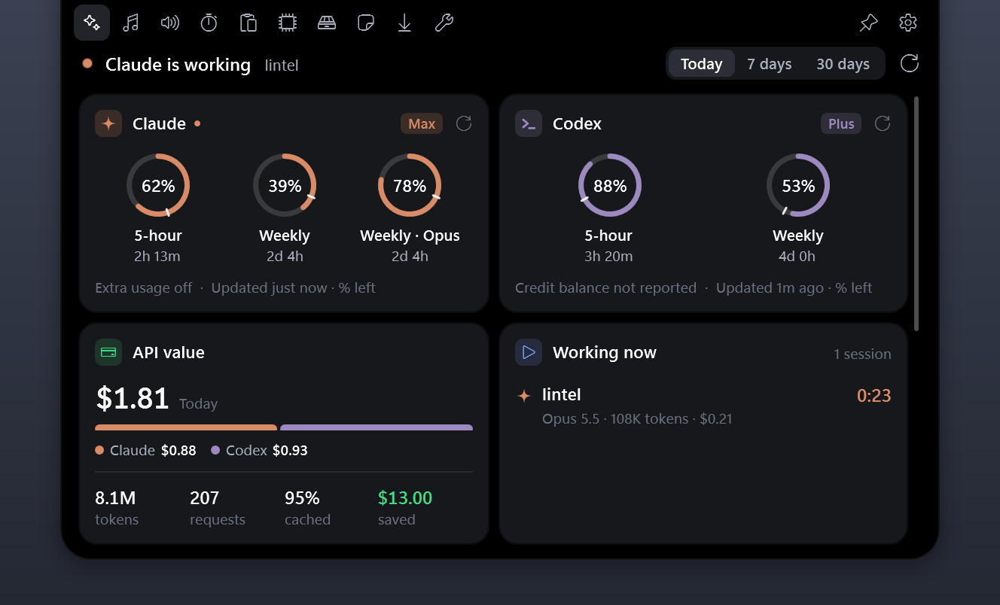
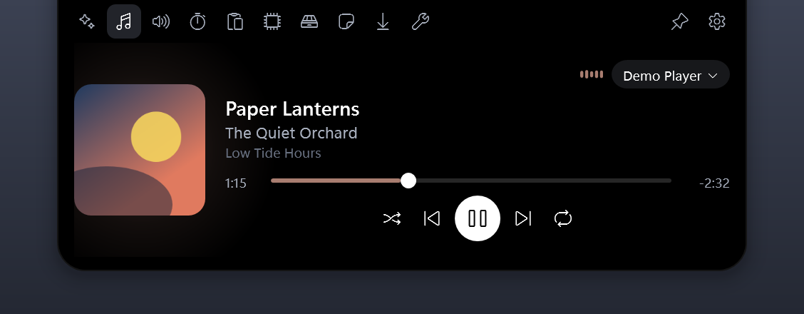
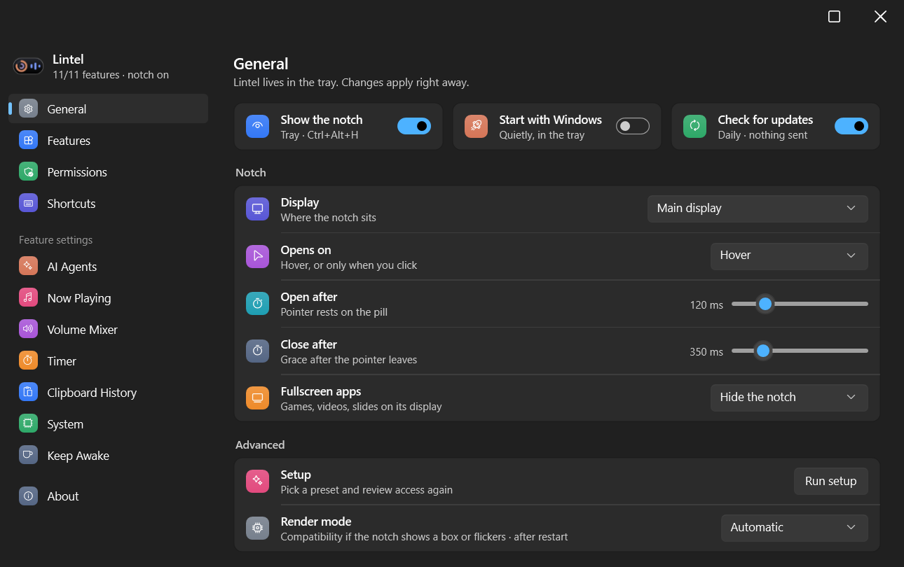

# Lintel

A Dynamic-Island-style notch for Windows: a small pill at the top centre of your screen that shows AI plan quotas, what's playing and a running timer, and springs open into pages when you hover it.

<p align="center">
  <br>
  
</p>

<p align="center">
  
  
</p>

Lintel lives in the tray. It has no main window, never shows up in the taskbar, never steals focus, and only the pill itself is clickable.

## Install

Windows 10 (2004+) or Windows 11, x64. In PowerShell:

```powershell
irm https://raw.githubusercontent.com/nio808/Lintel/main/install.ps1 | iex
```

From a Command Prompt:

```bat
powershell -c "irm https://raw.githubusercontent.com/nio808/Lintel/main/install.ps1 | iex"
```

No administrator rights and no .NET needed. The script downloads the latest `Lintel-win-x64.zip` from GitHub Releases, verifies its SHA-256 against the release's `SHA256SUMS.txt`, installs to `%LOCALAPPDATA%\Programs\Lintel`, adds a Start-menu shortcut and an entry in Settings > Apps, and starts Lintel (look for the tray icon). Run it again to upgrade; Lintel also offers updates itself.

Options: `-Startup` (start with Windows), `-NoLaunch`, `-Version 1.2.3`, `-DryRun`. Pass them like this:

```powershell
& ([scriptblock]::Create((irm https://raw.githubusercontent.com/nio808/Lintel/main/install.ps1))) -Startup
```

> Builds are not code-signed yet. The script downloads the zip itself and checks its hash, so SmartScreen is not involved. See [Troubleshooting](docs/TROUBLESHOOTING.md).

## Uninstall

Settings > Apps > Lintel > Uninstall, or:

```powershell
& ([scriptblock]::Create((irm https://raw.githubusercontent.com/nio808/Lintel/main/install.ps1))) -Uninstall
```

Add `-Purge` to also delete your settings and data in `%LOCALAPPDATA%\Lintel`.

## Features

Every feature is a module you switch on in Settings > Features. Each one asks only for the [permissions](docs/PERMISSIONS.md) it needs, in plain words.

- **AI Agents**: Claude, Codex, Copilot and OpenCode. Plan limits with reset times, tokens, API-equivalent cost, models and projects, and a notice when a long task finishes.
- **Now Playing** and **Volume Mixer**: whatever Windows reports as playing, with controls; per-app volume.
- **Timer** and **Keep Awake**: countdown, stopwatch, Pomodoro; keep the PC or display awake for a while.
- **System** and **Quick Toggles**: CPU, memory, network, battery; dark mode, mic mute, lock and more.
- **Clipboard**, **Shelf**, **Scratchpad**, **Downloads**: encrypted clipboard history, a place to park files, quick notes, downloads in progress.
- Global shortcuts, keyboard mode, hides over fullscreen apps, follows the main display or the pointer.

## Privacy

No account, no analytics, no crash upload. Nothing is read until you grant the permission. Network use is limited to an optional daily update check (GitHub), an optional daily price-list download (GitHub), and, only if you allow it, asking Anthropic for your Claude plan quota with your own Claude sign-in. Everything stays in `%LOCALAPPDATA%\Lintel`. Details: [PRIVACY.md](docs/PRIVACY.md).

## Build from source

Windows 10/11 x64 and PowerShell 5.1+. `build.ps1` uses a .NET 10 SDK from `PATH`, or installs one into `.dotnet\` in the repo.

```powershell
git clone https://github.com/nio808/Lintel; cd Lintel
./build.ps1 -All    # build, test, publish; release assets in artifacts\release
```

Other switches: `-Test`, `-Publish`, `-Zip`, `-Clean`, `-CompressExe`, `-Version x.y.z`, `-ShowPlan`. `Lintel.exe --demo` shows canned data instead of reading your accounts. How it fits together: [ARCHITECTURE.md](docs/ARCHITECTURE.md). Contributing: [CONTRIBUTING.md](CONTRIBUTING.md).

## Credits

The AI-usage log parsing, pricing logic and seed price list are adapted from vorssaint-utils (GPL-3.0-or-later). Built with WPF-UI, CommunityToolkit.Mvvm, NAudio and ZstdSharp. See [NOTICE.md](NOTICE.md). Not affiliated with Anthropic, OpenAI or GitHub.

## License

[GPL-3.0-or-later](LICENSE).
